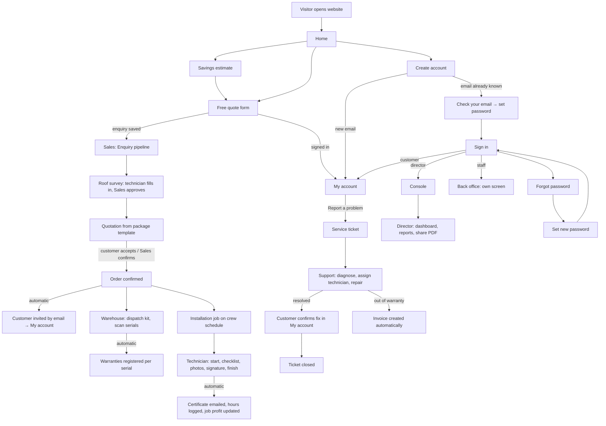

# SunPower: workflow, pages and project tracker

One product, three surfaces:

| Surface | Address | Who uses it |
|---|---|---|
| **Website** (React) | http://localhost:5173 (or the port Vite prints) | Visitors, customers, the Director's Console |
| **Back office** | http://localhost:8069 | Sales, warehouse, technicians, support, Director |
| **Crew app** | http://localhost:8069/technician | Technicians on their phone |

The website talks to the back office through `/api/sunpower/*` (and `/web/session/*` for sign-in). Both share one sign-in session, so signing in on the website also signs you in to the back office.

---

## 1. The whole journey, start to finish

### Step by step

| # | Who | Screen | What they see / enter | Action → what happens | Next | If something goes wrong |
|---|---|---|---|---|---|---|
| 1 | Visitor | **Home** `/` | Company story, stats, how it works, packages with subsidy, installation photos | "Book a free survey" → `/quote`; "Estimate your savings" → `/estimate` | Quote or estimate | n/a |
| 2 | Visitor | **Savings estimate** `/estimate` | Monthly bill or units (or upload a bill photo, read by AI) | Instant system size, savings, payback; "Book your free site survey" form under the result | Enquiry saved | Bill can't be read → asks to type the number; AI down → manual entry still works |
| 3 | Visitor | **Free quote** `/quote` | Size, type, bill, roof area, name, phone (required), email, address, subsidy | "Request my free quote" → enquiry in the Sales pipeline, salesperson auto-assigned, call-back activity due today | Thank-you screen with enquiry number; "Create an account to track it" | Missing name/phone → message; server down → toast with phone number |
| 4 | Visitor | **Create account** `/signup` | Name, email, phone (optional), password (min 8) | New email → customer account created and signed in → `/account`. Email already known → single-use link emailed instead (nobody can take over an account by typing its email) | My account, or "Check your email" | Inline errors per field; 3 attempts per email per hour |
| 5 | Anyone | **Sign in** `/login` | Email + password, "Continue with Google" (once a Client ID is set) | Lands on own screen: Director → Console, customer → My account, staff → their back-office screen | Role home | Wrong password → message + reset link; already signed in → sent home |
| 6 | Anyone | **Forgot password** `/forgot-password` → **Set password** `/reset-password?token=…` | Email; then new password twice (strength hint) | Same answer for every email (no account fishing). Link works once, 24 h | Sign in | Expired/used link → "Send a new link" |
| 7 | Customer | **My account** `/account` | Tabs: **System** (enquiry/order progress tracker, total/paid/balance, subsidy, quote PDF, "Review & accept quote"), **Warranties** (every serial, valid until, years left), **Service** (requests, technician, what was fixed, charge), **Profile** (details, change password) | "Report a problem" (from a warranty or the Service tab) → ticket; "Yes, it works" / "Still not working" on a fixed repair; save details; change password | Stays in account | Empty states for each tab with the next step; load error → "Try again"; refresh keeps the tab (`?tab=`) |
| 8 | Sales | Back office **Enquiry Pipeline** | All enquiries by stage | Log calls/WhatsApp (AI can read a pasted message), book survey | Survey | n/a |
| 9 | Technician | **My Surveys** | Own assigned surveys | Fill roof area, direction, shading, recommended kW | Sales approves | Technician cannot approve; Sales must |
| 10 | Sales | **Quotations & Orders** | Package template fills panels/inverter/structure, subsidy shown | Send quote (PDF/email/portal) → confirm | Order confirmed | Can't confirm without an approved survey |
| 11 | System | (automatic) | n/a | On confirm: delivery order to warehouse, installation job on crew schedule, subsidy file opened, **customer account created and invite emailed** | n/a | Customer without email → no invite (office can add one later) |
| 12 | Warehouse | **Dispatch** | Kit to pick | Scan serials → validate → warranties created per serial | Job ready | Serial missing → can't validate |
| 13 | Technician | **My Jobs** / crew app | Customer, address, kW, time | Start → checklist → photos (AI check) → customer signature → Finish | Done | Can't finish without checklist/signature |
| 14 | System | (automatic) | n/a | Certificate emailed, hours → pay, job profit refreshed | n/a | n/a |
| 15 | Support | **Service Tickets** | Customer complaints (from My account / phone) | Diagnose (AI suggests from fault code), assign, repair, resolve; out-of-warranty → invoice | Customer confirms in My account | "Still not working" reopens the ticket |
| 16 | Director | **Console** `/console` | KPIs (enquiries, orders, profit, collected, installs, repairs), jobs, open items | Period filter, search, "Open back office" | Back office reports | Non-directors see "This area is for directors" |
| 17 | Anyone | Sign out | n/a | Session ends everywhere | Home | n/a |

---

## 2. Pages and routes

### Website (React, `frontend/src`)

| Page | Route | Access | File |
|---|---|---|---|
| Home | `/` | Everyone | `pages/Home.jsx` |
| Savings estimate | `/estimate` | Everyone | `pages/Estimate.jsx` |
| Free quote | `/quote` | Everyone (prefilled when a customer is signed in) | `pages/Quote.jsx` |
| Create account | `/signup` | Visitors | `pages/Signup.jsx` |
| Sign in | `/login` | Visitors | `pages/Login.jsx` |
| Forgot password | `/forgot-password` | Everyone | `pages/ForgotPassword.jsx` |
| Set / reset password | `/reset-password?token=…[&welcome=1]` | Holder of the emailed link | `pages/ResetPassword.jsx` |
| My account | `/account[?tab=warranties\|service\|profile]` | Customers | `pages/Account.jsx` |
| Console | `/console` | Director | `console/Console.jsx` |
| Sign out | `/logout` | Signed in | `pages/Logout.jsx` |
| Not found | anything else | Everyone | `pages/NotFound.jsx` |

**Navigation.** The top bar has Solar · Savings · Quote, plus **My account** for customers or **Console** for the Director. On the right: Sign in, or the person's name, "My screen" (staff) and Sign out. The "Free survey" button is always there. On phones, all of this moves into the bubble menu. **Footer** columns: Explore · Customers (My account, Create an account, Report a problem) · Team (Staff sign-in, Crew app) · Contact.

### Website API (`addons/sunpower_website/controllers`)

| Endpoint | Purpose |
|---|---|
| `/api/sunpower/estimate`, `/api/sunpower/enquiry` | Savings maths, save enquiry (linked to the customer when signed in) |
| `/api/sunpower/me` | Who is signed in, role, home screen |
| `/api/sunpower/auth/signup` | Customer self sign-up |
| `/api/sunpower/auth/providers`, `/auth/after-login` | Google sign-in |
| `/api/sunpower/auth/reset`, `/reset/check`, `/reset/confirm` | Password reset / first password |
| `/api/sunpower/my/overview` | Customer's enquiries, orders, warranties, tickets |
| `/api/sunpower/my/complaint`, `/my/ticket/confirm`, `/my/ticket/reopen` | Raise a problem, confirm or reopen a repair |
| `/api/sunpower/my/profile`, `/my/password` | Edit details, change password |

### Who can open what

| Area | Director | Sales | Warehouse | Technician | Support | Customer |
|---|---|---|---|---|---|---|
| Console (website) | ✅ | – | – | – | – | – |
| My account (website) | – | – | – | – | – | ✅ own |
| Enquiries & surveys | ✅ | ✅ (approves surveys) | – | own surveys | read | – |
| Quotes & orders | ✅ | ✅ | read | – | read | own |
| Job cost & profit | ✅ | – | – | – | – | – |
| Dispatch & stock | ✅ | read | ✅ | serials of own jobs | read serials | – |
| Installation jobs | ✅ | read | read | own jobs | read | progress only |
| Warranties | ✅ | read | read | own jobs | read | own |
| Service tickets | ✅ | read | – | own tickets | ✅ (no delete) | own |
| Reports, settings | ✅ | – | – | – | – | – |

---

## 3. Design system (`frontend/src/styles.css`)

| Token | Value / rule |
|---|---|
| Colours | Ink `#1d1d1f`, secondary `#6e6e73`, background white / `#f5f5f7`, accent sun-orange `#e8740c`, success `#1a8f3c`, error `#d70015` |
| Type | Inter / system font. Display `clamp(48–96px)`, headline `clamp(34–56px)`, body 17px, labels 13px |
| Layout | Centred `.wrap` max 1080px (narrow 760px) with 24px side padding (20px on phones). Sections 72–128px vertical rhythm |
| Grid | `.grid--2/3/4`, which collapse to 2 columns ≤960px and 1 column ≤734px |
| Buttons | Primary = black pill; secondary = grey pill; text link with › arrow. One primary action per block |
| Cards | 28px radius, grey (`card--alt`) for forms, outlined (`card--outline`) for records |
| Forms | Label above input, inline red error under the field, a summary error box at the top for server errors |
| States | Skeleton shimmer while loading; empty state = title + explanation + next action; success = toast + updated data; error = message + "Try again" |
| Status pills | Grey = new/neutral, orange = in progress / waiting for you, green = done / active |
| Images | Real photos (Unsplash licence, credits in `public/img/CREDITS.md`), `object-fit: cover`, 28px radius, no placeholders |
| Breakpoints | Desktop > 960px · tablet 735–960px · phone ≤ 734px (bubble menu, stacked tracker, card lists instead of tables) |

---

## 4. Project tracker

| Area | Status | Checked by |
|---|---|---|
| Website pages: home, estimate, quote | COMPLETED | Browser (desktop + phone) |
| Real photos replacing drawn placeholders | COMPLETED | All 7 photos load; credits file |
| Sign in, role homes, Console guard | COMPLETED | Browser per role, `test_access.py` |
| Forgot / reset password | COMPLETED | Browser, phase check P11 |
| Customer sign-up (with account-takeover protection) | COMPLETED | Browser, `test_account.py` |
| My account: system progress, warranties, service, profile | COMPLETED | Browser with demo customer, `test_account.py` |
| Raise problem, confirm / reopen repair | COMPLETED | `test_account.py`, browser (preselect) |
| Customer invited automatically on order confirmation | COMPLETED | `test_access.py::test_invite_customer_once` |
| Enquiries linked to signed-in customer | COMPLETED | Browser (enquiry shows in account) |
| Roles & permissions (6 roles, record rules) | COMPLETED | 15 access/flow tests, 92 phase checks |
| Sales pipeline shows whole team's enquiries | COMPLETED | Browser |
| No engine name visible ("Open back office", tab title "SunPower - …") | COMPLETED | Browser |
| Back-office address in one setting (`VITE_ENGINE_URL`) | COMPLETED | Build |
| Enquiry form answers in < 1 s (staff emails queued) | COMPLETED | Timed: 8.5 s → 0.45 s |
| Real emails (reset, invite, notifications) | **BLOCKED** | Needs the Gmail app password (see below). Emails are queued and go out once it's set |
| Google sign-in | **BLOCKED** | Needs a Google OAuth Client ID (see below). Button appears automatically once it's set |
| Online payment of the advance | NOT STARTED | Needs a payment provider account (e.g. Razorpay). Today: offline payment recorded by the office |
| Back office visual style (purple engine theme) | NOT STARTED | Works and is branded "SunPower", but not restyled to match the website |

### Unblocking

- **Email:** Back office → Settings → Technical → Outgoing Mail Servers → **Gmail**. Enter your Gmail address and a Gmail *app password*, then tick *Active*.
- **Google:** In Google Cloud Console, create an OAuth client ID (Web) with redirect URI `http://localhost:8069/auth_oauth/signin`. Then go to Back office → Settings → Integrations → OAuth Authentication (on) → OAuth Providers → **Google OAuth2**, paste the Client ID and tick *Allowed*.

---

## 5. Demo logins (password `sunpower`)

| Role | Login | Lands on |
|---|---|---|
| Director | `director@sunpower.demo` (or `admin` / `admin`) | Console |
| Sales | `sales@sunpower.demo` | Enquiry pipeline |
| Warehouse | `warehouse@sunpower.demo` | Dispatch |
| Support | `support@sunpower.demo` | Service tickets |
| Technician | `tech01@sunpower.demo` … `tech15@sunpower.demo` | My Jobs |
| Customer | `customer01@sunpower.demo` | My account |
